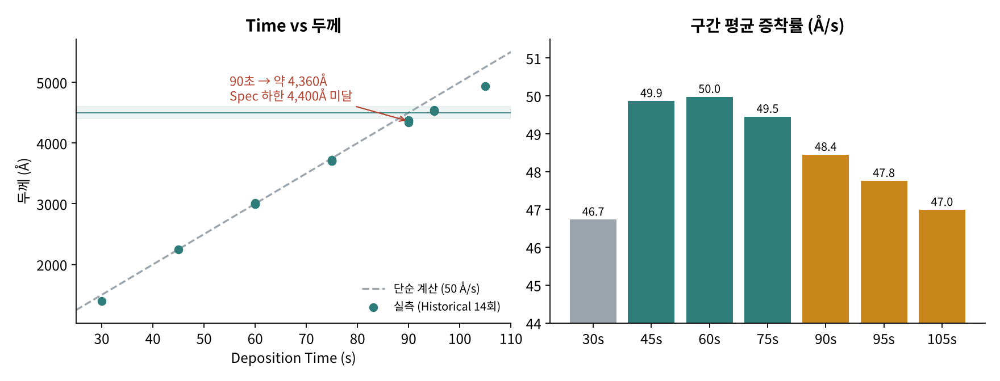
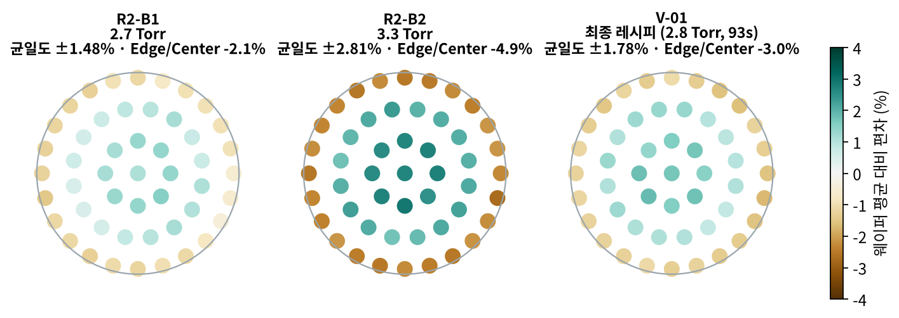
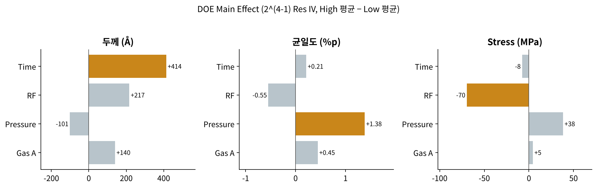
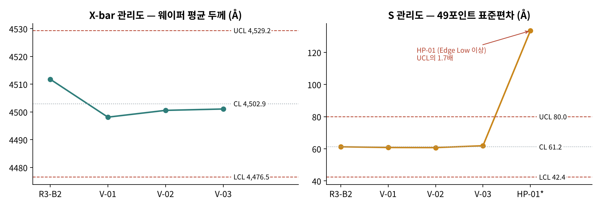

# 첨단소자 전문가 양성과정

## 과정 개요
- **기관:** 한국산업기술시험원 (KTL)
- **수료번호:** KTL26-K00001-00080
- **기간:** 2026.07.21 ~ 2026.10.16, 총 400시간 (수료)
- **내용:** NCS 기반 실무중심 과정 — 반도체 공정 이론·실습 + 품질 방법론

## 교과목 구성 (총 400시간)

| 교과목 | 시간 |
|---|---|
| 반도체 제조공정 기술 | 112 |
| 품질경영엔지니어(QME) | 48 |
| Six Sigma | 40 |
| 반도체 산업 및 기술 이해 | 40 |
| ISO 9001 심사원 과정 | 32 |
| 이차전지 공정 개요 | 32 |
| 자기개발능력 | 32 |
| 반도체 첨단소자 및 패키징 기술 | 24 |
| 전기전자 부품 개요 | 16 |
| AI 디스플레이 | 16 |
| 이미지 센서 기술 | 8 |

## 취득 자격·인증

| 자격·인증 | 발급 | 등급 / 결과 |
|---|---|---|
| Six Sigma Green Belt (6GB) | KTL, 2026.08.14 (인증번호: 6GB-PS26-00222) | Competent |
| 품질경영엔지니어 (QME) | KTL / PCAA, 2026.09.28 (인증번호: QME-PS26-00114) | Quality Engineer 등급 합격 |
| ISO 9001:2015 QMS 선임심사원 (Lead Auditor) | KTL / PCAA, 2026.10.19 (인증번호: QMS-PS26-01018) | Competent (QMS·AMS 역량 인증) |

## Six Sigma GB — DMAIC 프로젝트 (현대자동차 FCA 리콜 대상 팀 프로젝트)

### Define
- SWOT/SO/WO/ST/WT 분석으로 문제 영역 도출
- CTQ 3개 선정: FCA 오탐율, 대당 보증수리비용, 리콜 수리 리드타임
- SMARTA 평가 기준으로 Tucson·Santa Cruz FCA 리콜 건을 프로젝트로 선정 (90점)

### Measure
- 관련 프로세스를 9개 공정으로 정의하고 측정 기준 수립

### Analyze
- 피쉬본 다이어그램 + 5M1E 분석으로 원인 후보 도출
- PFMEA로 9개 공정별 위험도(RPN) 평가
- 최종 조립·검사 공정에서 RPN 441로 최고치 확인

### Improve
RPN이 가장 높았던 최종 조립·검사 공정을 개선 대상으로 선정.
검사 기준의 모호함과 작업자 숙련도 편차를 해소하기 위해 다음을 제안:

- 검사 체크리스트를 정량 기준(수치·허용오차)으로 표준화 → 검사자 간 판단 편차 축소
- FCA 센서 캘리브레이션 주기 단축 → 오탐 발생 가능성 사전 차단
- 포카요케(Poka-Yoke) 장치 도입 → 검사 누락 방지

### Control
- 9개 공정명 기준으로 관리계획(Control Plan) 수립

### 팀워크 에피소드
CTQ 우선순위와 SWOT 강약점 판단에서 팀원 간 의견이 갈렸을 때,
각자 데이터·근거를 다시 점검하게 해서 합의를 이끌어냄.

---

## 반도체 WORKSHOP — ETCH 공정 수율 분석 DMAIC 팀 프로젝트 (4조)

> 팀원: 황창열·전승현·유준상·김영표
> ETCH 공정에서 실제 25장 wafer 데이터를 가지고 DMAIC 방법론을 직접 적용한 프로젝트.
> Six Sigma GB에서 배운 내용을 반도체 공정 데이터에 처음으로 붙여본 사례.

### Define
- 대상: ETCH 공정, wafer 25장 (3,500 die/wafer, 총 87,500 die)
- Wafer map에서 Edge Ring 쪽에 결함 집중, 특정 quadrant 반복 패턴 확인
- 문제정의: ETCH 공정에서 Edge 방향으로 치우친 systematic defect 패턴 발생
- 개선목표: Edge Ring 결함 비중과 Level 7(고위험) wafer 비율 감소

### Measure

25장을 결함 개수 기준으로 분류:

| Level | wafer 수 | 비율 |
|---|---|---|
| Level 1 (양호) | 6장 | 24% |
| Level 4 (중간) | 11장 | 44% |
| Level 7 (심각) | 8장 | 32% |

- Defect 위치 분포: Edge Ring 55.5% / Inner Ring 31.4% / Center 13.1%
- Edge Ring 비중 55.5%가 이후 Analyze 방향을 결정

### Analyze
**가설 설정**
- H0: wafer 내 위치에 따른 CD Bias 차이는 우연적 편차, Recipe Parameter와 무관
- H1: Edge 영역이 Center 대비 통계적으로 유의하게 Over-Etch, Recipe Parameter가 근본 원인

**검증 결과 → H1 채택**
- Edge 평균 −2.75nm vs Center 평균 −0.44nm → Gap −2.31nm, 25장 전수에서 방향 일치
- Severe 7장 평균 −3.85nm vs 나머지 18장 −1.68nm → 2.3배 차이
- 전기적 특성(Yield/Vt/Idsat/Ioff/Rc)에서도 Severe 판정 wafer가 동시에 악화

**Recipe Parameter별 정량 근거**

| Parameter | 근거 | Edge 불량 연관성 |
|---|---|---|
| Bias Power | Edge−Center Gap −2.31nm | Ion energy 과다 → Edge 과식각 |
| Pressure | Edge −2.75nm | 저압 → 과도한 directionality |
| Gas Flow Ratio | 평균 Range 2.70nm | 반경 방향 분포 불균일 |
| Etch Time / Source Power | 전체 평균 −2.29nm | 설정값 자체 과다 |

### Improve
CD Bias 실측 편차를 근거로 조정 폭을 수치로 제시:

| Parameter | 조정 방향 | 권장 조정폭 |
|---|---|---|
| Bias Power | 감소 | 8~10% ↓ |
| Pressure | 증가 | 5~8% ↑ |
| Gas Flow Ratio | Edge측 재분배 | 약 10% 재분배 |
| Etch Time | 감소 | 6~8% ↓ |
| Source Power | 변동성 관리 | SPC ±3% 이내 |

기대 효과: Level 7 비율 32% → 10%, Edge Ring 결함 비중 55.5% → 25%

### Control
- Recipe Parameter SPC 관리 + Chamber Condition(PM/Clean/Seasoning 이력) 병행
- Edge Ring defect 비율 초과 시 Chamber Check
- 동일 quadrant cluster 2 lot 이상 반복 시 Equipment Signature로 판단
- PM 전/후 Wafer Map Trend 비교 의무화

### 배운 점
- Analyze 단계에서 가설(H0/H1)을 먼저 세우고 데이터로 기각/채택을 판단하는 순서가 왜 중요한지 체감
- "1순위 원인"과 "관리해야 할 범위"는 다른 질문 — 원인 분석에서 설비를 배제해도 Control에서는 포함해야 재발을 막을 수 있음
- CD Bias 5-point 데이터 하나로 여러 원인 후보를 동시에 정량적으로 뒷받침 가능

---

## 반도체 WORKSHOP — CVD Golden Recipe 개발 (DMAIC 보고서)

> 3,000Å 양산 레시피(60초)를 4,500Å 레시피로 바꾸는 과제.
> 4개 조의 실험 데이터(웨이퍼 33장, 49포인트 측정)를 합쳐 분석하고, DMAIC 보고서(19장)로 정리해 제출.
> "시간만 1.5배 늘리면 된다"는 첫 가설이 왜 틀렸는지부터 검증한 프로젝트.
> ※ 과제 데이터는 교육용 상대값이며 실제 장비 값이 아님.

### 최종 레시피

| Parameter | 기존 (3,000Å) | Golden (4,500Å) | 근거 |
|---|---|---|---|
| Deposition Time | 60 s | **93 s** | 증착률 비선형 모델 + 2.8Torr 증착률 48.4Å/s |
| Pressure | 3.0 Torr | **2.8 Torr** | 균일도에 가장 큰 영향, 범위 하한(2.7)까지 여유 0.1Torr |
| RF Power | 500 W | 500 W | 올리면 Stress·RI·Particle 동시 악화 |
| Gas A | 100 sccm | 100 sccm | 올리면 균일도 악화 |
| Temp / Gas B / Carrier | 400°C / 800 / 1,000 | 고정 | 과제 고정 변수 |

**검증 결과 (같은 조건 3장 연속)**
- 평균 두께 4,498 / 4,501 / 4,501Å → 목표 대비 오차 최대 2Å (Spec ±100Å)
- 균일도 최대 ±1.78% (Spec ±2.0%)
- 웨이퍼 간 편차 0.03% (Spec 1.5%)
- RI·Stress·Particle 포함 8개 판정 항목 전부 PASS → **3장 연속 PASS**

### Define
- 목표: 두께 4,500±100Å, 균일도 ±2.0% 이내, 웨이퍼 간 편차 1.5% 이내, RI·Stress·Particle Spec 충족, **3장 연속 PASS**
- 조절 변수: Time 85~95s, RF 450~550W, Pressure 2.7~3.3Torr, Gas A 90~110sccm
- 핵심 질문: 60초 × 1.5 = 90초면 정말 4,500Å이 나오는가?

### Measure
**Baseline 3장**: 평균 2,999~3,016Å, 증착률 50.0~50.3Å/s로 안정적. 다만 균일도가 이미 ±1.5~1.6%로 Spec의 80%를 쓰고 있었고, Edge가 Center보다 2.0~2.3% 얇았음 → 이후 분석의 첫 단서

**증착률은 선형이 아님**

- 60초 이후 증착률이 50 → 47.8Å/s로 떨어짐 (초반은 Incubation, 후반은 반응물 고갈로 해석)
- 90초로 증착하면 약 4,360Å → Spec 하한 4,400Å 미달

| 예측 모델 | 4,500Å 필요 시간 |
|---|---|
| 단순 계산 (50Å/s) | 90.0 s |
| 선형 Fit (R² = 0.996) | 93.2 s |
| 2차 Fit | 93.7 s |
| 90~95s 보간 | 94.0 s |

→ **판단: 90초 기각, 93~94초대로 수정**

### Analyze
**Round 2 결과: 시간만 늘린 조는 균일도에서 FAIL**
- Time만 조정(85/90/95s): 95초에서 두께는 4,528Å로 합격이지만 균일도 ±2.14%로 FAIL
- 막이 두꺼워질수록 Edge Low가 심해짐 → 두께와 별개로 균일도를 잡을 변수가 필요

**Edge Low는 압력에 따라 달라짐**

- 같은 90초에서 압력만 2.7 → 3.3Torr로 올리면 Edge 편차 −2.1% → −4.9%, 균일도 ±1.48% → ±2.81%
- 원인 가설: 압력에 따른 반응물 전달(확산 길이·체류 시간) 차이

**DOE로 변수 역할 분리 (2^(4-1) 부분요인설계 + Center 2점, Pooled 10장)**

| 변수 | 두께 | 균일도 | Stress | 역할 |
|---|---|---|---|---|
| Time | **+414Å** | +0.21%p | −8 | 두께 조절 |
| Pressure | −101Å | **+1.38%p** | +38 | 균일도 조절 (낮출수록 개선) |
| RF | +217Å | −0.55%p | **−70MPa** | 부작용 큼 (RI·Particle도 증가) |
| Gas A | +140Å | +0.45%p | +5 | 균일도 악화 |

- 교호작용 최대 20Å(주효과의 약 5%), 곡률 −17Å로 작음 → 범위 안에서는 선형 보정으로 충분
- 한계: Resolution IV라 2인자 교호작용끼리 교락(AB=CD 등)

→ **판단: 두께는 Time, 균일도는 Pressure로 맞추고 RF·Gas A는 고정**

### Improve
**왜 2.7이 아니라 2.8Torr인가**
- 2.7Torr(R3-B1)가 균일도 ±1.47%로 더 좋았지만, 허용 범위의 끝이라 압력이 조금만 내려가도 범위 밖
- 2.8Torr는 하한까지 0.1Torr 여유 확보. 아래 이웃(2.7)은 PASS가 확인됨
- **가장 좋은 값이 아니라 여유가 있는 값을 선택**

**시간 93초 결정**: 2.8Torr 증착률 약 48.4Å/s 기준 4,500 ÷ 48.4 ≈ 93초 → 실측 4,512Å

**기각한 대안**
- RF 520W 조합(92s): 1초 짧지만 Stress −217MPa로 Spec 하한(−250) 여유가 작고 재현성 미검증
- Time만 조정(94.5s): 균일도 ±2.18%로 FAIL

### Control
**X-bar / S 관리도 (부분군 = 웨이퍼 1장의 49포인트)**

- 기준: 같은 조건 4장 (R3-B2, V-01~03)
- X-bar: CL 4,502.9Å / UCL 4,529.2 / LCL 4,476.5 → 4장 모두 관리 상태
- S: CL 61.2Å / UCL 80.0 / LCL 42.4 → 4장 모두 60.7~61.9Å로 안정
- 이상 웨이퍼 HP-01: 평균은 4,347Å로 평범하지만 S = 133.4Å로 UCL의 1.7배 → **평균만 보면 놓치는 Edge Low 이상을 S 관리도가 잡아냄** (HP-01은 90초 조건이라 참고용)
- 기준이 4장뿐이라 관리 한계는 잠정치. 양산 20~25장 누적 후 재산정 필요

**Spec 소진율로 관리 우선순위 결정**

| 항목 | 3장 중 최악값 ÷ 허용폭 | 관리 우선순위 |
|---|---|---|
| 균일도 | 89% | 1 |
| Particle | 80% | 2 |
| Stress | 35% | 3 |
| RI | 23% | 3 |
| 두께·웨이퍼 간 편차·증착률 | 2% | 3 |

**이상 조치 흐름 (OCAP)**: S 관리도 UCL 초과 → Lot 보류 → Wafer Map 패턴 판독 → Edge Low면 압력·Showerhead·Edge 온도 점검 → Seasoning 후 확인 웨이퍼 1장 PASS 시 재개

### 남은 과제
- 균일도 여유가 0.22%p뿐 → 2.75~2.85Torr 추가 분할 실험으로 여유 확인
- 2.9Torr는 미실험이라 위쪽 Process Window는 확인 필요
- 공정 시간이 60s → 93s로 증가 → RF를 건드리지 않고 시간을 줄이는 방법은 다음 개선 주제

### 배운 점
- "4,500Å가 나왔다"는 Golden Recipe의 근거가 아님 — 두께·균일도·막질·재현성을 동시에 만족하고, 변수마다 선택 이유를 설명할 수 있어야 함
- 단순 계산(선형 가정)을 먼저 데이터로 검증하는 습관: 증착률은 시간에 따라 변함
- DOE로 변수의 역할을 분리하면 "어떤 손잡이로 무엇을 맞출지"가 명확해짐
- 최적값보다 Process Window 여유가 양산에서 더 중요할 수 있음
- 평균만 보는 관리로는 분포 이상(Edge Low)을 놓침 → 49포인트 S 관리도 + Edge/Center 비율을 함께 봐야 함
