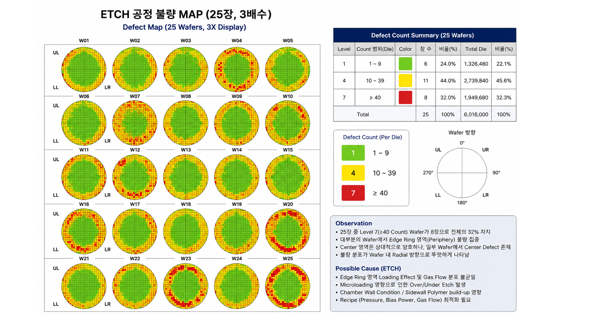

# 한국산업기술시험원 — 첨단소자 전문가 양성과정 (K-Digital Training)

## 과정 개요
- **기관:** 한국산업기술시험원 (KTL)
- **수료번호:** KTL26-K00001-00080
- **기간:** 2026.07.21 ~ 2026.10.16, 총 400시간 (수료)
- **내용:** NCS 기반 실무중심 과정 — 반도체 공정 이론·실습 + 품질 방법론

## 교과목 구성 (총 400시간)

| 교과목 | 시간 |
|---|---|
| 반도체 제조공정 기술 | 112 |
| 품질경영엔지니어(QME) | 48 |
| Six Sigma | 40 |
| 반도체 산업 및 기술 이해 | 40 |
| ISO 9001 심사원 과정 | 32 |
| 이차전지 공정 개요 | 32 |
| 자기개발능력 | 32 |
| 반도체 첨단소자 및 패키징 기술 | 24 |
| 전기전자 부품 개요 | 16 |
| AI 디스플레이 | 16 |
| 이미지 센서 기술 | 8 |

## 취득 자격·인증

| 자격·인증 | 발급 | 등급 / 결과 |
|---|---|---|
| Six Sigma Green Belt (6GB) | KTL, 2026.08.14 (인증번호: 6GB-PS26-00222) | Competent |
| 품질경영엔지니어 (QME) | KTL / PCAA, 2026.09.28 (인증번호: QME-PS26-00114) | Quality Engineer 등급 합격 |
| ISO 9001:2015 QMS 선임심사원 (Lead Auditor) | KTL / PCAA, 2026.10.19 (인증번호: QMS-PS26-01018) | Competent (QMS·AMS 역량 인증) |

## Six Sigma GB — DMAIC 프로젝트 (현대자동차 FCA 리콜 대상 팀 프로젝트)

### Define
- SWOT/SO/WO/ST/WT 분석으로 문제 영역 도출
- CTQ 3개 선정: FCA 오탐율, 대당 보증수리비용, 리콜 수리 리드타임
- SMARTA 평가 기준으로 Tucson·Santa Cruz FCA 리콜 건을 프로젝트로 선정 (90점)

### Measure
- 관련 프로세스를 9개 공정으로 정의하고 측정 기준 수립

### Analyze
- 피쉬본 다이어그램 + 5M1E 분석으로 원인 후보 도출
- PFMEA로 9개 공정별 위험도(RPN) 평가
- 최종 조립·검사 공정에서 RPN 441로 최고치 확인

### Improve
RPN이 가장 높았던 최종 조립·검사 공정을 개선 대상으로 선정.
검사 기준의 모호함과 작업자 숙련도 편차를 해소하기 위해 다음을 제안:

- 검사 체크리스트를 정량 기준(수치·허용오차)으로 표준화 → 검사자 간 판단 편차 축소
- FCA 센서 캘리브레이션 주기 단축 → 오탐 발생 가능성 사전 차단
- 포카요케(Poka-Yoke) 장치 도입 → 검사 누락 방지

### Control
- 9개 공정명 기준으로 관리계획(Control Plan) 수립

### 팀워크 에피소드
CTQ 우선순위와 SWOT 강약점 판단에서 팀원 간 의견이 갈렸을 때,
각자 데이터·근거를 다시 점검하게 해서 합의를 이끌어냄.

---

## 반도체 WORKSHOP — ETCH 공정 수율 분석 DMAIC 팀 프로젝트 (4조)

> 팀원: 황창열·전승현·유준상·김영표
> ETCH 공정에서 실제 25장 wafer 데이터를 가지고 DMAIC 방법론을 직접 적용한 프로젝트.
> Six Sigma GB에서 배운 내용을 반도체 공정 데이터에 처음으로 붙여본 사례.

### Define
- 대상: ETCH 공정, wafer 25장 (3,500 die/wafer, 총 87,500 die)
- Wafer map에서 Edge Ring 쪽에 결함 집중, 특정 quadrant 반복 패턴 확인
- 문제정의: ETCH 공정에서 Edge 방향으로 치우친 systematic defect 패턴 발생
- 개선목표: Edge Ring 결함 비중과 Level 7(고위험) wafer 비율 감소

### Measure

25장을 결함 개수 기준으로 분류:

| Level | wafer 수 | 비율 |
|---|---|---|
| Level 1 (양호) | 6장 | 24% |
| Level 4 (중간) | 11장 | 44% |
| Level 7 (심각) | 8장 | 32% |

- Defect 위치 분포: Edge Ring 55.5% / Inner Ring 31.4% / Center 13.1%
- Edge Ring 비중 55.5%가 이후 Analyze 방향을 결정

### Analyze
**가설 설정**
- H0: wafer 내 위치에 따른 CD Bias 차이는 우연적 편차, Recipe Parameter와 무관
- H1: Edge 영역이 Center 대비 통계적으로 유의하게 Over-Etch, Recipe Parameter가 근본 원인

**검증 결과 → H1 채택**
- Edge 평균 −2.75nm vs Center 평균 −0.44nm → Gap −2.31nm, 25장 전수에서 방향 일치
- Severe 7장 평균 −3.85nm vs 나머지 18장 −1.68nm → 2.3배 차이
- 전기적 특성(Yield/Vt/Idsat/Ioff/Rc)에서도 Severe 판정 wafer가 동시에 악화

**Recipe Parameter별 정량 근거**

| Parameter | 근거 | Edge 불량 연관성 |
|---|---|---|
| Bias Power | Edge−Center Gap −2.31nm | Ion energy 과다 → Edge 과식각 |
| Pressure | Edge −2.75nm | 저압 → 과도한 directionality |
| Gas Flow Ratio | 평균 Range 2.70nm | 반경 방향 분포 불균일 |
| Etch Time / Source Power | 전체 평균 −2.29nm | 설정값 자체 과다 |

### Improve
CD Bias 실측 편차를 근거로 조정 폭을 수치로 제시:

| Parameter | 조정 방향 | 권장 조정폭 |
|---|---|---|
| Bias Power | 감소 | 8~10% ↓ |
| Pressure | 증가 | 5~8% ↑ |
| Gas Flow Ratio | Edge측 재분배 | 약 10% 재분배 |
| Etch Time | 감소 | 6~8% ↓ |
| Source Power | 변동성 관리 | SPC ±3% 이내 |

기대 효과: Level 7 비율 32% → 10%, Edge Ring 결함 비중 55.5% → 25%

### Control
- Recipe Parameter SPC 관리 + Chamber Condition(PM/Clean/Seasoning 이력) 병행
- Edge Ring defect 비율 초과 시 Chamber Check
- 동일 quadrant cluster 2 lot 이상 반복 시 Equipment Signature로 판단
- PM 전/후 Wafer Map Trend 비교 의무화

### 배운 점
- Analyze 단계에서 가설(H0/H1)을 먼저 세우고 데이터로 기각/채택을 판단하는 순서가 왜 중요한지 체감
- "1순위 원인"과 "관리해야 할 범위"는 다른 질문 — 원인 분석에서 설비를 배제해도 Control에서는 포함해야 재발을 막을 수 있음
- CD Bias 5-point 데이터 하나로 여러 원인 후보를 동시에 정량적으로 뒷받침 가능
